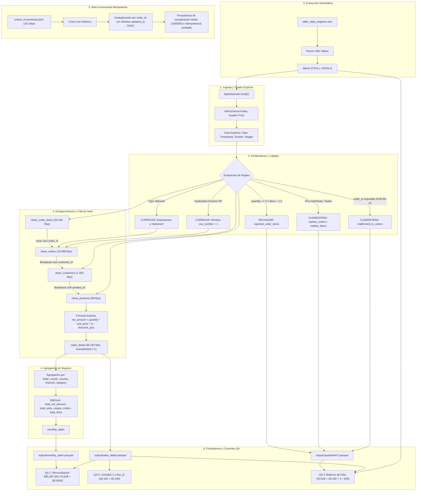

# Taller local: Data Engineer Junior Advanced
### Pipeline ETL de Ventas con Python, PySpark y Spark SQL

Este repositorio contiene la solución completa, modular, documentada e idempotente para el **Taller local: Data Engineer Junior Advanced**. El proyecto procesa las ventas sintéticas de una tienda de comercio minorista en Latinoamérica utilizando **PySpark en modo local (`local[*]`)**, resolviendo problemas de calidad, reconciliación contable, integridad referencial y procesamiento incremental sin requerir infraestructura en la nube (Azure, Databricks, ADLS ni Delta Lake).

---

## 📥 Cómo Clonar y Descargar el Repositorio

Para clonar y comenzar a trabajar con este proyecto en tu computadora local, ejecuta en tu terminal (PowerShell, Bash o Zsh):

```bash
# 1. Clonar el repositorio
git clone https://github.com/juanvargasviloria2507-gif/taller-data-enginer.git

# 2. Entrar a la carpeta del proyecto
cd taller-data-enginer
```

> **Alternativa sin Git:** Si no tienes Git instalado en tu máquina, puedes hacer clic en el botón verde **"Code"** en GitHub y seleccionar **"Download ZIP"**, luego descomprimir la carpeta en tu equipo.

---

## 📋 Tabla de Contenidos
1. [Requisitos y Herramientas Necesarias](#-requisitos-y-herramientas-necesarias)
2. [Guía de Instalación y Configuración por Sistema Operativo](#-guía-de-instalación-y-configuración-por-sistema-operativo)
   - [Windows](#opción-a-windows-10--11)
   - [Linux / macOS](#opción-b-linux-ubuntu-debian-o-macos)
3. [Estructura del Proyecto](#-estructura-del-proyecto)
4. [Flujo Integral del Pipeline (Arquitectura)](#-flujo-integral-del-pipeline-arquitectura)
5. [Cómo Ejecutar el Proyecto](#-cómo-ejecutar-el-proyecto)
   - [Modo 1: Script Automatizado (`taller_etl.py`)](#modo-1-ejecución-completa-vía-script-taller_etlpy)
   - [Modo 2: Notebook Interactivo (`taller_etl.ipynb`)](#modo-2-ejecución-interactiva-vía-notebook-taller_etlipynb)
6. [Detalle de Fases y Lógica de Negocio](#-detalle-de-fases-y-lógica-de-negocio)
7. [Controles de Calidad (QA) y Verificación](#-controles-de-calidad-qa-y-verificación)
8. [Preguntas de Discusión y Fundamentos Teóricos](#-preguntas-de-discusión-y-fundamentos-teóricos)

---

## 🛠 Requisitos y Herramientas Necesarias

Para ejecutar este taller en cualquier laptop u ordenador se requieren las siguientes herramientas base:

1. **Python 3.10, 3.11 o 3.12:**
   - Interprete de Python para correr el entorno virtual y la API de PySpark.
2. **Java Development Kit (JDK 17 o JDK 21):**
   - Apache Spark se ejecuta sobre la Máquina Virtual de Java (JVM). Se recomienda Microsoft OpenJDK 21, Eclipse Temurin 17/21 o Amazon Corretto.
3. **Editor de Código:**
   - **VS Code** (con extensiones de Python y Jupyter) o **JupyterLab**.
4. **Git** (opcional, para clonar el repositorio).

---

## 💻 Guía de Instalación y Configuración por Sistema Operativo

### Opción A: Windows (10 / 11)

#### 1. Instalar Java JDK (si no lo tienes)
Descarga e instala **Microsoft OpenJDK 21** o **Eclipse Temurin 21**:
- [Microsoft Build of OpenJDK 21](https://learn.microsoft.com/es-es/java/openjdk/download)
- Verifica la instalación abriendo PowerShell:
  ```powershell
  java -version
  ```

#### 2. Clonar o Descargar el Proyecto
Abre PowerShell en la carpeta donde descargaste el proyecto:
```powershell
cd C:\ruta\a\tu\carpeta\taller-data-enginer
```

#### 3. Crear y Activar el Entorno Virtual
```powershell
# Crear entorno virtual .venv
python -m venv .venv

# Activar el entorno virtual
.\.venv\Scripts\Activate.ps1
```
*(Si PowerShell bloquea la activación de scripts por política de ejecución, ejecuta una sola vez: `Set-ExecutionPolicy -Scope Process -ExecutionPolicy Bypass`).*

#### 4. Instalar PySpark
```powershell
pip install pyspark==3.5.6 py4j
```

#### 5. Configuración de Hadoop / Winutils en Windows (Manejo de Parquet)
Spark requiere en Windows los binarios `winutils.exe` y `hadoop.dll` para escribir archivos locales (como Parquet) sin error de permisos.
El proyecto incluye un descargador automático o puedes configurarlo manualmente ejecutando en PowerShell:
```powershell
New-Item -ItemType Directory -Force -Path ".\hadoop\bin"
Invoke-WebRequest -Uri "https://raw.githubusercontent.com/cdarlint/winutils/master/hadoop-3.3.6/bin/winutils.exe" -OutFile ".\hadoop\bin\winutils.exe"
Invoke-WebRequest -Uri "https://raw.githubusercontent.com/cdarlint/winutils/master/hadoop-3.3.6/bin/hadoop.dll" -OutFile ".\hadoop\bin\hadoop.dll"
```
*(El script `taller_etl.py` y el notebook detectan automáticamente esta carpeta `hadoop/` y configuran las variables `HADOOP_HOME` y `PATH` en memoria).*

---

### Opción B: Linux (Ubuntu / Debian) o macOS

En sistemas operativos Unix (Linux/macOS), Spark funciona de forma nativa sin necesidad de winutils.

#### 1. Instalar Java (OpenJDK 17 o 21)
- **Ubuntu/Debian:**
  ```bash
  sudo apt update
  sudo apt install -y openjdk-21-jdk
  ```
- **macOS (con Homebrew):**
  ```bash
  brew install openjdk@21
  ```
- Verifica en la terminal:
  ```bash
  java -version
  ```

#### 2. Crear y Activar Entorno Virtual
```bash
cd /ruta/a/taller-data-enginer
python3 -m venv .venv
source .venv/bin/activate
```

#### 3. Instalar PySpark
```bash
pip install pyspark==3.5.6 py4j
```

---

## 📁 Estructura del Proyecto

```text
taller-data-enginer/
│
├── taller_data_engineer.xlsx       # Libro de Excel original con las 6 hojas de datos
├── Taller Spark.pdf                # Guía y enunciado del taller técnico
├── taller_etl.py                   # Script Python ejecutable completo y automatizado
├── taller_etl.ipynb                # Jupyter Notebook interactivo celda por celda
├── README.md                       # Documentación técnica completa
│
├── datos/                          # Archivos extraídos listos para Spark (generados automáticamente)
│   ├── customers.csv               # Clientes (1.001 registros crudos)
│   ├── products.csv                # Productos (100 registros crudos)
│   ├── orders.csv                  # Pedidos históricos (20.001 registros crudos)
│   ├── order_items.csv             # Líneas de pedido (40.026 registros crudos)
│   └── incremental/
│       ├── orders_incremental.jsonl      # Lote incremental de órdenes (101 registros)
│       └── order_items_incremental.jsonl # Lote incremental de líneas (200 registros)
│
├── hadoop/bin/                     # Binarios winutils.exe y hadoop.dll (requeridos solo en Windows)
│   ├── winutils.exe
│   └── hadoop.dll
│
└── output/                         # Resultados finales persistidos en Parquet
    ├── sales_detail.parquet        # Detalle de ventas validado (39.190 filas limpias)
    ├── monthly_sales.parquet       # Agregado mensual (mes, país, canal, categoría)
    └── quarantine/                 # Tablas de auditoría y aislamiento
        ├── orphan_orders.parquet
        ├── malformed_ts_orders.parquet
        ├── orphan_order_items.parquet
        └── rejected_order_items.parquet
```

---

## 🔄 Flujo Integral del Pipeline (Arquitectura)



---

## 🚀 Cómo Ejecutar el Proyecto

### Modo 1: Ejecución Completa vía Script (`taller_etl.py`)
Es el método preferido para ejecutar el pipeline de principio a fin de forma desatendida y automática.

1. Activa tu entorno virtual:
   - **Windows:** `.\.venv\Scripts\Activate.ps1`
   - **Linux/macOS:** `source .venv/bin/activate`
2. Ejecuta el script:
   ```bash
   python taller_etl.py
   ```
3. Observarás en consola la salida detallada por fases, el desglose de anomalías tratadas y la validación inmediata de los controles de calidad con assertions.

---

### Modo 2: Ejecución Interactiva vía Notebook (`taller_etl.ipynb`)
El notebook está diseñado para **exponer, enseñar, defender técnicamente o depurar** el taller celda por celda.

#### ¿Cómo funciona `taller_etl.ipynb` paso a paso?

1. **Abre el notebook en VS Code o JupyterLab:**
   - En VS Code, abre el archivo `taller_etl.ipynb`.
   - En la esquina superior derecha, selecciona el Kernel de Python correspondiente a tu entorno virtual (`.venv`).
2. **Estructura de las Celdas:**
   - **Celda 1 (Setup del Entorno):** Configura `PYSPARK_PYTHON` y detecta `hadoop/winutils` automáticamente.
   - **Celda 2 (Fase 1 - Ingesta):** Crea la `SparkSession` local, lee los 4 CSVs con `inferSchema=False` y aplica el tipado fuerte (`cast`). Imprime esquemas con `printSchema()`.
   - **Celda 3 (Fase 2 - Calidad de Datos):** Aplica la lógica de saneamiento:
     - Deduplica `customers` y `orders`.
     - Corrige el typo `'deliverd'` $\rightarrow$ `'delivered'`.
     - Filtra y separa pedidos con fechas mal formadas a cuarentena.
     - Ejecuta las validaciones de claves foráneas huérfanas hacia cuarentena.
     - Rechaza líneas con `quantity <= 0` o `discount_pct > 1.0`.
   - **Celda 4 (Fase 3 - Joins y Cálculo Neto):** Une las tablas preservando la granularidad de `line_id` con *broadcast joins* para evitar *shuffles* innecesarios y calcula `net_amount`.
   - **Celda 5 (Fase 4 - Agregaciones):** Ejecuta la agregación mensual multidimensional y muestra la tabla resumen formateada.
   - **Celda 6 (Fase 5 - Reto Incremental):** Carga los JSONL incrementales, ejecuta la deduplicación con ventana sobre `updated_at DESC`, comprueba que el pedido `O00005` tomó la fecha más reciente y demuestra la idempotencia al reinyectar el lote.
   - **Celda 7 (Fase 6 - Persistencia y QA):** Escribe los DataFrames en formato Parquet bajo `output/` y ejecuta los 3 tests unitarios de reconciliación y balance.

---

## 📊 Detalle de Fases y Lógica de Negocio

### 1. Ingesta y Tipado Explícito
Se desactiva la inferencia de esquemas (`inferSchema=False`) para evitar lecturas lentas y conversiones impredecibles. Se aplica tipado canónico:
- `signup_date`: `to_date(col("signup_date"), "yyyy-MM-dd")`
- `order_ts` y `updated_at`: `to_timestamp(col(...))`
- `quantity`: `IntegerType()`
- `unit_price` y `discount_pct`: `DoubleType()`

### 2. Tratamiento Justificado de Anomalías
- **Corregir:** 1 cliente duplicado (`C0020`), 1 pedido duplicado (`O00012`) y 1 estado con error tipográfico (`deliverd`).
- **Rechazar:** 3 líneas de pedido inválidas (`L0000001` con cantidad 0, `L0000002` con cantidad -2, y `L0000005` con descuento 1.20 = 120%).
- **Cuarentena:** 1 pedido con fecha imposible (`O00025`), 2 pedidos con cliente inexistente o nulo (`C9999`, vacío), 2 productos con precio negativo o nulo (`P088`, `P089`), y 833 líneas de pedido asociadas a pedidos o productos en cuarentena o inexistentes.

### 3. Preservación de Granularidad y Fórmula Neta
La granularidad más atómica es la línea de artículo (`line_id`).
- La fórmula aplicada estrictamente es:
  $$\text{net\_amount} = \text{round}(\text{quantity} \times \text{unit\_price} \times (1 - \text{discount\_pct}), 2)$$
- Al unir `order_items` ($N$) con `orders` ($1$), `customers` ($1$) y `products` ($1$), se garantiza que **ningún importe se duplique**.

### 4. Reto Incremental Idempotente
- Para absorber el lote incremental (`orders_incremental.jsonl`), se realiza un `unionByName` con el histórico y se aplica una función de ventana:
  ```python
  Window.partitionBy("order_id").orderBy(col("updated_at").desc())
  ```
- Conservando el registro con `row_number() == 1`, se garantiza:
  1. Que pedidos nuevos (`O20001` al `O20100`) se agreguen.
  2. Que pedidos con actualización tardía (`O00005`) adopten el estado más reciente (`updated_at = 2026-03-05`).
  3. Que re-ejecutar el pipeline con los mismos datos sea **100% idempotente** (sin registros duplicados).

---

## 🔍 Controles de Calidad (QA) y Verificación

El pipeline implementa tres controles de calidad automatizados con aserciones estrictas:

```text
[CONTROL QA 1] Reconciliación de Importe Neto:
    - Suma detalle (sales_detail):   $95,297,643.79
    - Suma agregado (monthly_sales):  $95,297,643.79
    - Diferencia absoluta:           $0.0000
    => RESULTADO: PASÓ (100% Reconciliado)

[CONTROL QA 2] Unicidad de Clave Primaria en Join:
    - Total filas en sales_detail:   39.190
    - Distinct line_id en resultado: 39.190
    => RESULTADO: PASÓ (Granularidad 1:1 exacta, sin multiplicación de importes)

[CONTROL QA 3] Balance Total de Filas (order_items):
    - Total inicial crudo:       40.026
    - Limpios procesados:        39.190
    - Rechazados (dominio):      3
    - En cuarentena (huérfanos): 833
    - Suma contable (L+R+C):     40.026
    => RESULTADO: PASÓ (Cero filas descartadas silenciosamente)
```

---

## 💡 Preguntas de Discusión y Fundamentos Teóricos

1. **¿Cuál es la granularidad de cada archivo y qué claves la garantizan?**
   - `customers.csv`: Granularidad por cliente individual ($1:1$), garantizada por `customer_id`.
   - `products.csv`: Granularidad por artículo de catálogo ($1:1$), garantizada por `product_id`.
   - `orders.csv`: Granularidad por transacción / encabezado ($1:1$), garantizada por `order_id`.
   - `order_items.csv`: Granularidad máxima atómica: línea de artículo de un pedido ($1:1$), garantizada por `line_id`.

2. **¿Qué diferencia hay entre corregir, rechazar y poner en cuarentena?**
   - **Corregir:** Normalización determinística de errores tipográficos o deduplicación canónica donde la intención es indiscutible y no se inventan datos.
   - **Rechazar:** Filas que violan leyes lógicas o físicas del dominio (ej. cantidades negativas o descuentos $> 100\%$) que no pueden participar en balances de ventas.
   - **Cuarentena:** Aislamiento de transacciones financieras reales que carecen de integridad referencial o tienen atributos dimensionales corruptos, para su posterior auditoría y reparación por el equipo de datos.

3. **¿Qué operaciones son transformaciones y cuáles disparan una acción de Spark?**
   - **Transformaciones (Lazy Evaluation):** Definen el grafo de ejecución (DAG).
     - *Narrow (sin shuffle):* `select()`, `filter()`, `withColumn()`, `when()`.
     - *Wide (con shuffle):* `join()`, `groupBy()`, `distinct()`, `dropDuplicates()`, `orderBy()`.
   - **Acciones (Eager Execution):** Materializan el grafo y disparan el cómputo distribuido: `count()`, `show()`, `collect()`, `write.parquet()`.

4. **¿Cómo evitas multiplicar totales al agregar después de un join?**
   - Tomando siempre como tabla base del join aquella con la máxima granularidad del cálculo (`order_items`).
   - Manteniendo relaciones $N:1$ hacia las dimensiones maestras (`orders`, `customers`, `products`).
   - Empleando `broadcast()` sobre dimensiones de tamaño reducido para evitar cartesianos y sobrecosto de *shuffle*.

5. **¿Qué limitaciones tiene probar Spark en modo local frente a un clúster?**
   - **Latencia de Red Inexistente:** `local[*]` comparte la memoria del host y no evalúa la transferencia física entre nodos.
   - **Simulación Irreal de Memoria:** No detecta cuellos de botella de contención de memoria en el *driver/executors*, derrames a disco (*disk spill*) ni particiones desbalanceadas (*data skew*) que surgen al procesar cientos de gigabytes o terabytes.
   - **Sin Tolerancia a Fallos Distribuida:** En modo local, un fallo en el proceso detiene la aplicación completa; en un clúster, Spark reasigna dinámicamente las tareas caídas a otros nodos activos.
